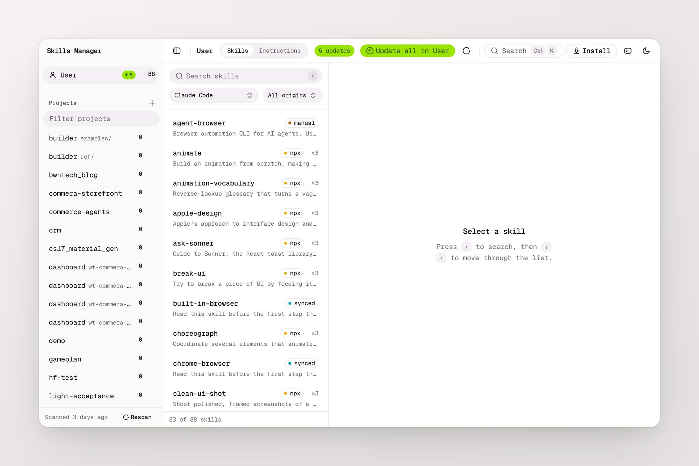
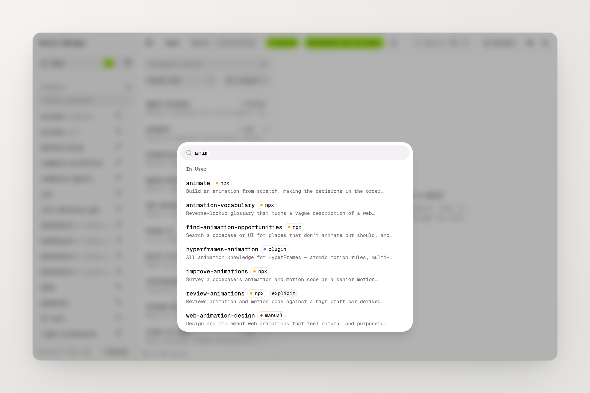
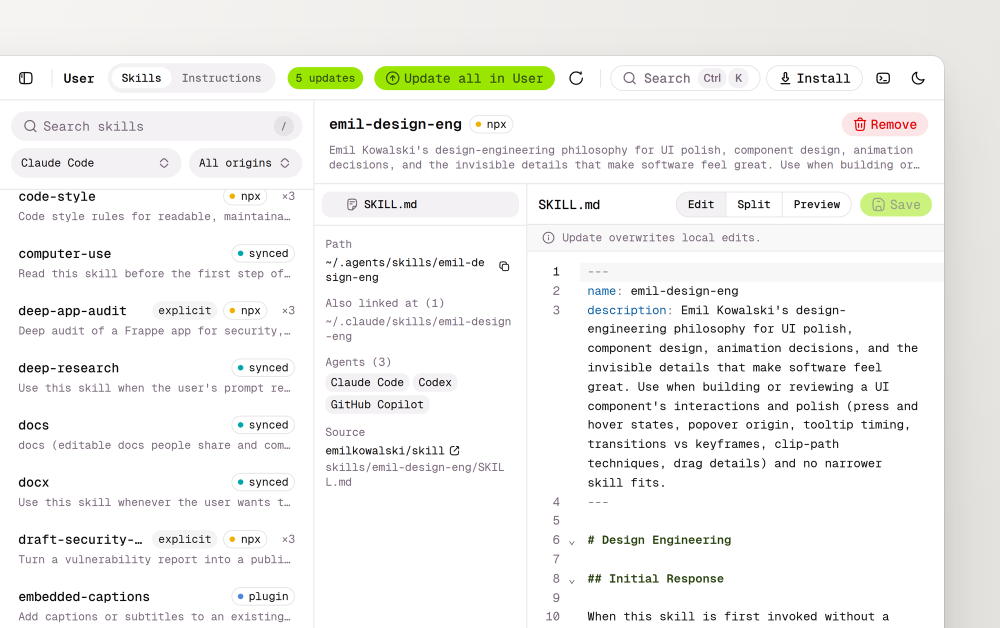
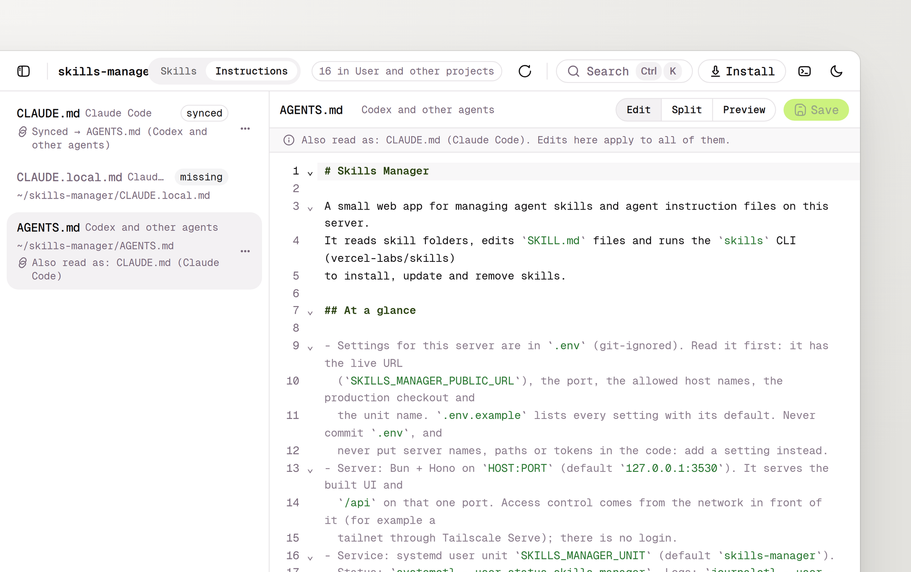
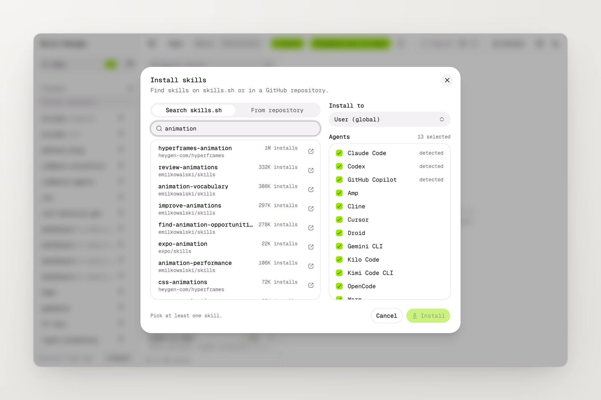
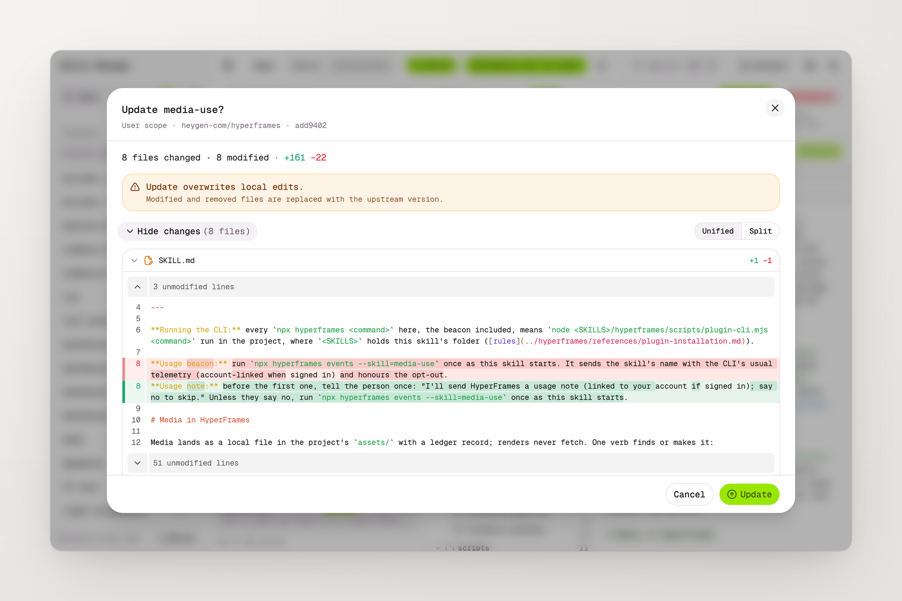

# Skills Manager

A small web app to manage the agent skills and agent instruction files on one server.

Coding agents such as Claude Code, Codex and GitHub Copilot read skills (folders with a
`SKILL.md`) and instruction files (`CLAUDE.md`, `AGENTS.md`). On a server with many agents and
projects, these files are in many folders. Skills Manager shows all of them in one place. You can
read and edit them, and install, update and remove skills with the
[`skills` CLI](https://github.com/vercel-labs/skills).



## What it does

### Browse all skills

- Shows the skills of every agent that the `skills` CLI supports, at user level and in each
  project. Filter by agent and by origin.
- Shows each skill folder once, with the agents that read it.
- An origin badge tells where a skill comes from: `npx` (installed with the CLI), `manual`,
  `plugin`, `synced` or `system`.
- Press Cmd/Ctrl+K to go to any skill in any scope.



### Edit skills

- Edit `SKILL.md` and the other Markdown files of `npx` and `manual` skills. Other files are
  read-only.
- The editor has Markdown and YAML highlighting, and Edit, Split and Preview modes.
- It checks the frontmatter: `name` and `description` must be present, and `name` must match the
  folder name.
- You save explicitly (button or Cmd/Ctrl+S). If the file changed on disk, the app warns you.



### Edit instruction files

- Edit `CLAUDE.md`, `CLAUDE.local.md` and `AGENTS.md` at user level and in each project, and
  create the ones that are missing.
- Sync one file to others: for example, make `CLAUDE.md` a symlink to `AGENTS.md`, so that all
  agents read the same text. You see a diff before the change, and the app keeps a backup.



### Install skills

- Search [skills.sh](https://skills.sh), or paste a GitHub `owner/repo` and pick skills from it.
- Install at user level or in one project, for the agents that you select.



### Update and remove skills

- Looks for updates on start and when you click Refresh.
- Before an update, shows the diff between your copy and the upstream version.
- Update one skill or all of them. The CLI output shows in a log drawer.
- Removes a skill after you confirm.



## Run it

You need [Bun](https://bun.sh).

```sh
bun install
cp .env.example .env    # then set the values for your server
bun run build
bun server/index.ts     # serves the UI and the API on http://127.0.0.1:3530
```

For development, run `bun run dev:server` and `bun run dev` (Vite on port 5530).

The app has no login. Run it on a private network only, for example a tailnet through Tailscale
Serve, and add that host name to `SKILLS_MANAGER_ALLOWED_HOSTS` in `.env`. `.env.example` lists
all settings.

## Stack

Bun and Hono on the server, React 19, Vite and shadcn/ui in the browser, CodeMirror 6 for the
editor. [AGENTS.md](AGENTS.md) has the details for contributors and coding agents.

## License

[MIT](LICENSE)
